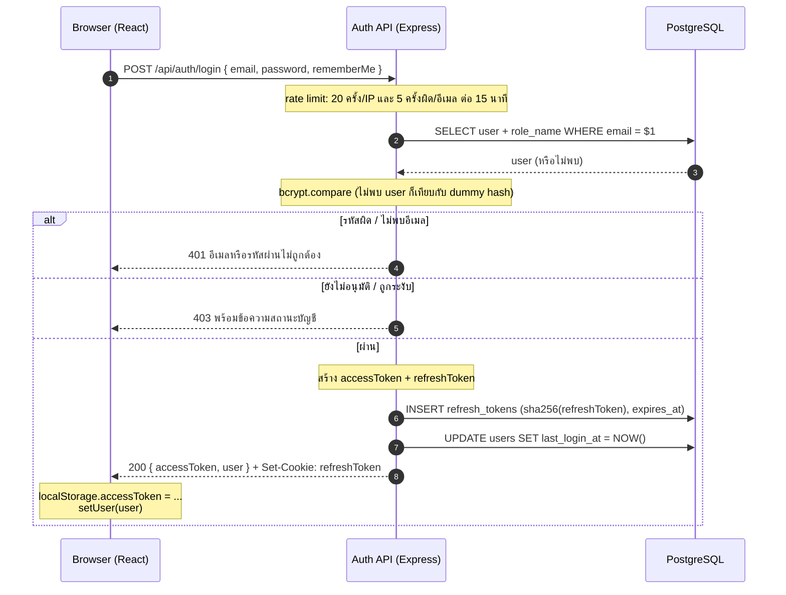
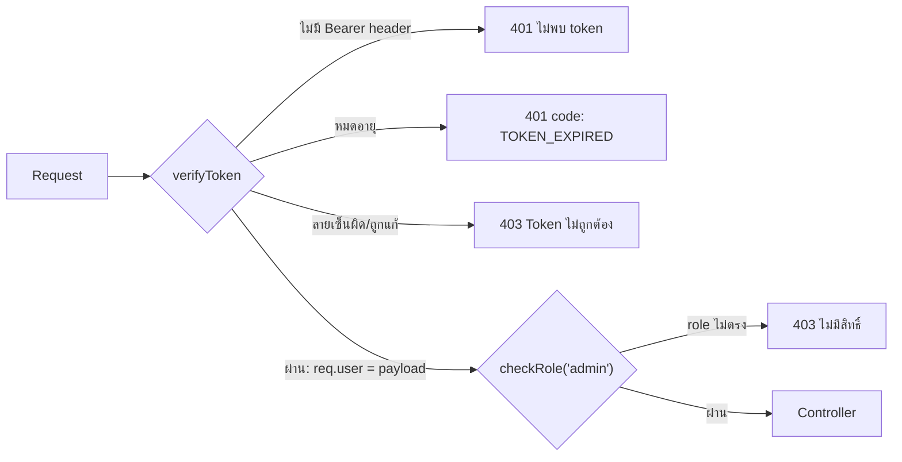
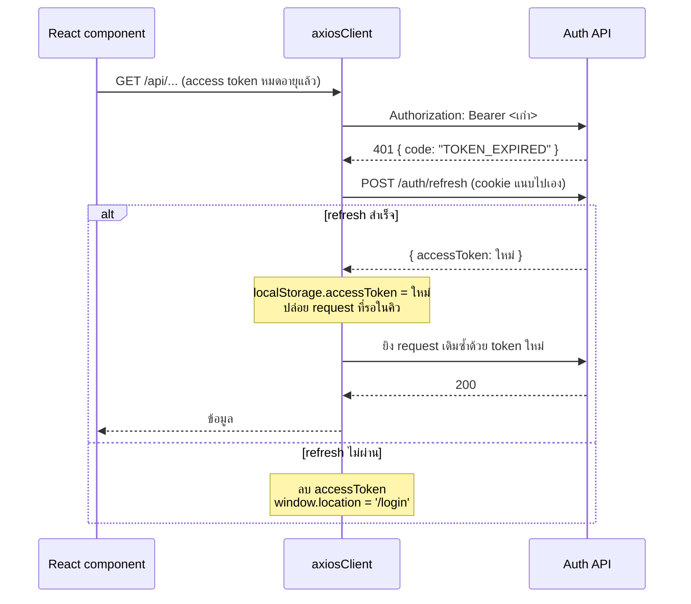

# ระบบ Login ด้วย JWT — GISTDA Eddy Auth API

เอกสารนี้อธิบายว่าระบบ login ของ `server/auth` ทำงานอย่างไร ตั้งแต่ผู้ใช้กดปุ่มเข้าสู่ระบบ ไปจนถึงการต่ออายุ token และการออกจากระบบ
อ้างอิงจากโค้ดจริงในโฟลเดอร์นี้และฝั่ง frontend (`src/api/axiosClient.js`, `src/context/AuthContext.jsx`)

> 📄 มีเวอร์ชันหน้าเว็บพร้อมแผนภาพที่ [`JWT_LOGIN_FLOW.html`](./JWT_LOGIN_FLOW.html) — เปิดด้วยเบราว์เซอร์ได้เลย
>
> วิธีติดตั้งและตั้งค่า ดูที่ [`README.md`](./README.md)

## สารบัญ

1. [ภาพรวม: token สองตัว](#1-ภาพรวม-token-สองตัว)
2. [ขั้นตอน Login](#2-ขั้นตอน-login)
3. [ข้างใน JWT](#3-ข้างใน-jwt)
4. [การป้องกัน route ด้วย middleware](#4-การป้องกัน-route-ด้วย-middleware)
5. [การต่ออายุ token (Refresh)](#5-การต่ออายุ-token-refresh)
6. [Logout และการยกเลิก session](#6-logout-และการยกเลิก-session)
7. [API Reference](#7-api-reference)
8. [ข้อสังเกตจากโค้ดปัจจุบัน](#8-ข้อสังเกตจากโค้ดปัจจุบัน)
9. [แผนที่ไฟล์](#9-แผนที่ไฟล์)

---

## 1. ภาพรวม: token สองตัว

ระบบใช้ JWT สองตัวที่ทำหน้าที่ต่างกัน เพื่อให้ได้ทั้ง **ความเร็ว** (ไม่ต้อง query DB ทุก request) และ **ความปลอดภัย** (ยกเลิก session ได้จริง)

<table>
<tr><th></th><th>Access Token</th><th>Refresh Token</th></tr>
<tr><td><b>หน้าที่</b></td><td>แนบไปกับทุก request เพื่อบอกว่า "ฉันคือใคร มีสิทธิ์อะไร"</td><td>ใช้ขอ access token ใบใหม่เมื่อใบเดิมหมดอายุ</td></tr>
<tr><td><b>อายุ</b></td><td>สั้น — <code>15m</code> (<code>JWT_ACCESS_EXPIRES_IN</code>)</td><td>ยาว — <code>30d</code> ถ้าติ๊ก "จดจำฉัน" / <code>1d</code> ถ้าไม่ติ๊ก</td></tr>
<tr><td><b>Secret</b></td><td><code>JWT_ACCESS_SECRET</code></td><td><code>JWT_REFRESH_SECRET</code> (ต้องไม่ซ้ำกับตัวแรก)</td></tr>
<tr><td><b>Payload</b></td><td><code>user_id</code>, <code>email</code>, <code>role</code></td><td><code>user_id</code> เท่านั้น</td></tr>
<tr><td><b>ส่งกลับทาง</b></td><td>JSON body ของ <code>/login</code> และ <code>/refresh</code></td><td>cookie <code>refreshToken</code> (httpOnly)</td></tr>
<tr><td><b>ฝั่ง browser เก็บที่</b></td><td><code>localStorage['accessToken']</code></td><td>cookie — JavaScript อ่านไม่ได้</td></tr>
<tr><td><b>Server เก็บไว้ไหม</b></td><td>ไม่เก็บ (stateless)</td><td>เก็บ <b>SHA-256 hash</b> ในตาราง <code>refresh_tokens</code></td></tr>
<tr><td><b>ยกเลิกได้ไหม</b></td><td>ไม่ได้ — ใช้ได้จนหมดอายุ</td><td>ได้ — ตั้ง <code>revoked = TRUE</code></td></tr>
</table>

**หลักคิด:** access token อายุสั้นจนถ้าหลุดก็เสียหายไม่นาน ส่วน refresh token ที่อายุยาวถูกซ่อนไว้ใน httpOnly cookie และตรวจกับ DB ทุกครั้งที่ใช้ จึงยกเลิกได้

---

## 2. ขั้นตอน Login



รายละเอียดแต่ละขั้น ([`controllers/auth.controller.js`](./controllers/auth.controller.js) ฟังก์ชัน `login`):

| # | ขั้นตอน | ทำไมต้องทำ |
|---|---------|-----------|
| 1 | ผ่าน `loginIpLimiter` (20 ครั้ง/15 นาที ต่อ IP) และ `loginAccountLimiter` (ผิด 5 ครั้ง/15 นาที ต่ออีเมล — login สำเร็จไม่นับ) | กัน brute-force ทั้งจากเครื่องเดียว และจากหลายเครื่องที่รุมเดาบัญชีเดียว |
| 2 | ตรวจว่ามี `email` และ `password` | ไม่มี → `400` |
| 3 | ดึง user พร้อม `role_name` (JOIN `roles`) | ต้องใช้ role ไปฝังใน token |
| 4 | `bcrypt.compare` กับ `password_hash` — ถ้าไม่พบอีเมลจะเทียบกับ `DUMMY_PASSWORD_HASH` | ให้เวลาตอบเท่ากันทุกกรณี คนนอกจึงจับเวลาเดาไม่ได้ว่าอีเมลไหนมีในระบบ |
| 5 | รหัสผิดหรือไม่พบอีเมล → `401` ข้อความเดียวกัน | ไม่บอกว่าผิดที่อีเมลหรือรหัส |
| 6 | เช็ค `is_approved` แล้วค่อยเช็ค `is_active` → `403` | ทำ **หลัง** ยืนยันรหัสผ่าน เพื่อไม่ให้คนที่รู้แค่อีเมลไล่เช็คสถานะบัญชีได้ |
| 7 | `generateAccessToken(user)` และ `generateRefreshToken(user, '30d' \| '1d')` | ดู [ข้อ 3](#3-ข้างใน-jwt) |
| 8 | `INSERT INTO refresh_tokens` เก็บ **SHA-256 ของ refresh token** | ถ้า DB หลุด คนร้ายก็เอา hash ไปใช้แทน token ไม่ได้ |
| 9 | อัปเดต `last_login_at` | แสดงในหน้าจัดการผู้ใช้ |
| 10 | `Set-Cookie: refreshToken` แบบ `httpOnly`, `sameSite: strict`, `secure` (เฉพาะ production) | JavaScript อ่าน cookie ไม่ได้ (กัน XSS ขโมย) และไม่ถูกส่งจากเว็บอื่น (กัน CSRF) |
| 11 | ตอบ `{ message, accessToken, user }` | frontend เก็บ token และข้อมูลผู้ใช้ |

### "จดจำการเข้าสู่ระบบ" (rememberMe)

| | ติ๊ก | ไม่ติ๊ก |
|---|---|---|
| อายุ refresh JWT | `REMEMBER_ME_EXPIRES_IN` (30d) | `SESSION_EXPIRES_IN` (1d) |
| `expires_at` ใน DB | +30 วัน | +1 วัน |
| Cookie | มี `maxAge` 30 วัน → อยู่ข้ามการปิดเบราว์เซอร์ | ไม่มี `maxAge` → session cookie หายเมื่อปิดเบราว์เซอร์ |

---

## 3. ข้างใน JWT

สร้างใน [`utils/token.js`](./utils/token.js) ด้วย `jsonwebtoken` (อัลกอริทึม default คือ **HS256** — เซ็นด้วย secret ตัวเดียวกับที่ใช้ตรวจ)

JWT มี 3 ส่วนคั่นด้วยจุด: `header.payload.signature`

```jsonc
// Access token — payload หลัง decode
{
  "user_id": "3f6c1e2a-...-uuid",
  "email": "someone@gistda.or.th",
  "role": "admin",        // มาจาก roles.role_name
  "iat": 1761980400,      // ออกเมื่อ (unix time)
  "exp": 1761981300       // หมดอายุ = iat + 15 นาที
}

// Refresh token — payload หลัง decode
{
  "user_id": "3f6c1e2a-...-uuid",
  "iat": 1761980400,
  "exp": 1764572400       // iat + 30 วัน (หรือ 1 วัน)
}
```

> ⚠️ **payload ไม่ได้เข้ารหัส** — ใครก็ decode อ่านได้ (base64url) ลายเซ็นมีไว้กันการ **แก้ไข** เท่านั้น ห้ามใส่ข้อมูลลับลงใน payload

### การป้องกัน secret อ่อน

[`config/validateEnv.js`](./config/validateEnv.js) รันตอน start server ถ้าไม่ผ่านจะ `process.exit(1)` ทันที

- ต้องตั้ง `JWT_ACCESS_SECRET` และ `JWT_REFRESH_SECRET` ทั้งคู่
- ยาวอย่างน้อย 32 ตัวอักษร
- ห้ามมีคำแบบค่าตัวอย่าง (`change`, `replace`, `secret`, `example`, `your_`)
- สองตัวต้องไม่ซ้ำกัน — ถ้าซ้ำ คนที่มี refresh token จะเอาไปใช้แทน access token ได้

เหตุผล: ถ้า secret ว่างหรือเดาได้ ใครก็ปลอม token ที่มี `"role": "admin"` ได้เอง

---

## 4. การป้องกัน route ด้วย middleware



**[`middleware/verifyToken.js`](./middleware/verifyToken.js)**
- อ่าน `Authorization: Bearer <token>` แล้ว `jwt.verify` ด้วย `JWT_ACCESS_SECRET`
- ผ่าน → `req.user = { user_id, email, role, iat, exp }` ให้ controller ใช้ต่อ
- **ไม่ query DB** — เชื่อข้อมูลใน token ตรง ๆ (จึงเร็ว แต่ดู [ข้อสังเกต 5](#8-ข้อสังเกตจากโค้ดปัจจุบัน))
- แยก `401 TOKEN_EXPIRED` ออกจาก `403` เพื่อให้ frontend รู้ว่าควร refresh หรือควรเด้งไปหน้า login

**[`middleware/checkRole.js`](./middleware/checkRole.js)**
- ใช้ต่อจาก `verifyToken` เสมอ — `checkRole('admin')` เทียบ `req.user.role` กับรายการที่อนุญาต

ตัวอย่างการใช้:

```js
// routes/auth.routes.js — ต้อง login
router.get('/me', verifyToken, authController.me);

// routes/user.routes.js — ต้องเป็น admin ทุก route ในไฟล์
router.use(verifyToken, checkRole('admin'));
```

---

## 5. การต่ออายุ token (Refresh)

### ฝั่ง server — `POST /api/auth/refresh`

1. อ่าน cookie `refreshToken` — ไม่มี → `401`
2. `jwt.verify` ด้วย `JWT_REFRESH_SECRET` — ผิดหรือหมดอายุ → `403`
3. หา row ใน `refresh_tokens` ที่ `user_id` ตรง, `token_hash = sha256(token)`, `revoked = FALSE`, `expires_at > NOW()` — ไม่พบ → `403`
4. ดึง user + role **ล่าสุดจาก DB** — ไม่พบหรือ `is_active = FALSE` → `403`
5. ออก access token ใหม่ → `{ accessToken }`

ขั้นที่ 4 ทำให้การเปลี่ยน role หรือระงับบัญชีมีผลภายในรอบ refresh ถัดไป (ไม่เกิน 15 นาที)
refresh token ตัวเดิมยังใช้ต่อได้ (ไม่มีการหมุนเปลี่ยน — ดู [ข้อสังเกต 4](#8-ข้อสังเกตจากโค้ดปัจจุบัน))

### ฝั่ง frontend — refresh อัตโนมัติ



- [`src/api/axiosClient.js`](../../src/api/axiosClient.js) — request interceptor แนบ `Bearer` จาก `localStorage` ทุกครั้ง; response interceptor ดัก `401 TOKEN_EXPIRED` แล้ว refresh **ครั้งเดียว** — request ที่เป็นตัวสั่ง refresh จะยิงตัวเองซ้ำทันทีหลังได้ token ใหม่ ส่วน request อื่นที่หมดอายุพร้อมกันจะรอในคิว `refreshSubscribers` แล้วถูกปล่อยพร้อมกัน ไม่ refresh ซ้ำ
- [`src/context/AuthContext.jsx`](../../src/context/AuthContext.jsx) — ตอนเปิดหรือรีโหลดหน้า `restoreSession()` เรียก `/auth/refresh` → `/auth/me` เพื่อกู้ session จาก cookie (ผู้ใช้จึงไม่ต้อง login ใหม่ทุกครั้งที่กด F5)

---

## 6. Logout และการยกเลิก session

**`POST /api/auth/logout`** — revoke refresh token ตัวที่อยู่ใน cookie (`UPDATE refresh_tokens SET revoked = TRUE WHERE token_hash = ...`) แล้ว `clearCookie('refreshToken')` ตอบ `200` เสมอ แม้ไม่มี cookie
ฝั่ง frontend ลบ `accessToken` ออกจาก `localStorage` และ `setUser(null)`

กรณีที่ระบบ **revoke ทุก session ของผู้ใช้** (`WHERE user_id = ...`):

| เหตุการณ์ | Endpoint | หมายเหตุ |
|-----------|----------|---------|
| ตั้งรหัสใหม่จากลิงก์อีเมล | `POST /api/auth/reset-password` | ทำใน transaction เดียวกับการเปลี่ยนรหัส |
| เปลี่ยนรหัสผ่านเอง | `POST /api/auth/change-password` | ลบ cookie ของเครื่องปัจจุบันด้วย → ต้อง login ใหม่ |
| Admin ตั้งรหัสให้ | `PATCH /api/users/:id/reset-password` | บันทึก audit log |

> access token ที่ออกไปแล้วยังใช้ได้จนหมดอายุ (≤ 15 นาที) แม้ session ถูก revoke — เป็นข้อแลกเปลี่ยนของ JWT แบบ stateless

---

## 7. API Reference

Base URL: `http://localhost:5000/api` (dev) — บน Vercel ใช้ `/api` โดเมนเดียวกับ frontend (ดู `vercel.json` → `api/index.js`)

| Method | Endpoint | Auth | Body | Response สำเร็จ |
|--------|----------|------|------|----------------|
| POST | `/auth/register` | — | `{ email, password, full_name? }` | `201 { message, user }` (รอ admin อนุมัติ) |
| POST | `/auth/login` | — | `{ email, password, rememberMe? }` | `200 { message, accessToken, user }` + cookie |
| POST | `/auth/refresh` | cookie | — | `200 { accessToken }` |
| POST | `/auth/logout` | cookie | — | `200 { message }` + ลบ cookie |
| GET | `/auth/me` | Bearer | — | `200 { user }` |
| PATCH | `/auth/me` | Bearer | `{ full_name }` | `200 { message, user }` |
| POST | `/auth/change-password` | Bearer | `{ currentPassword, newPassword }` | `200 { message }` + ลบ cookie |
| POST | `/auth/forgot-password` | — | `{ email }` | `200 { message }` (ข้อความเดียวกันเสมอ) |
| POST | `/auth/reset-password` | — | `{ token, newPassword }` | `200 { message }` |

### รหัสสถานะที่ควรรู้

| Status | ความหมายในระบบนี้ | frontend ควรทำ |
|--------|------------------|---------------|
| `400` | ข้อมูลไม่ครบ / รหัสผ่านไม่ผ่าน policy | แสดง `message` หรือ `errors[]` |
| `401` | ไม่มี token, รหัสผิด, หรือ `code: TOKEN_EXPIRED` | ถ้าเป็น `TOKEN_EXPIRED` → refresh; อื่น ๆ → ไปหน้า login |
| `403` | token ปลอม, refresh ใช้ไม่ได้, บัญชีรออนุมัติ/ถูกระงับ, role ไม่พอ | แสดงข้อความ |
| `429` | เกิน rate limit | แสดงข้อความให้รอ |

<details>
<summary><b>ตัวอย่างทดสอบด้วย curl</b> (คลิกเพื่อดู)</summary>

```bash
# 1) Login — เก็บ cookie ไว้ในไฟล์ cookies.txt
curl -i -c cookies.txt -X POST http://localhost:5000/api/auth/login \
  -H "Content-Type: application/json" \
  -d '{"email":"admin@test.com","password":"Admin@12345","rememberMe":true}'

# 2) เรียก endpoint ที่ต้อง login — เอา accessToken จากข้อ 1 มาใส่
curl http://localhost:5000/api/auth/me \
  -H "Authorization: Bearer <accessToken>"

# 3) ขอ access token ใหม่ด้วย cookie
curl -b cookies.txt -X POST http://localhost:5000/api/auth/refresh

# 4) Logout
curl -b cookies.txt -c cookies.txt -X POST http://localhost:5000/api/auth/logout
```

หมายเหตุ: cookie ตั้ง `secure` เฉพาะ `NODE_ENV=production` จึงทดสอบผ่าน `http://localhost` ได้

</details>

<details>
<summary><b>ตัวอย่าง response ของ /auth/login</b></summary>

```json
{
  "message": "เข้าสู่ระบบสำเร็จ",
  "accessToken": "eyJhbGciOiJIUzI1NiIsInR5cCI6IkpXVCJ9.eyJ1c2VyX2lkIjoi...",
  "user": {
    "user_id": "3f6c1e2a-...",
    "email": "admin@test.com",
    "full_name": "System Administrator",
    "role": "admin"
  }
}
```

```
Set-Cookie: refreshToken=eyJhbGciOi...; Max-Age=2592000; Path=/; HttpOnly; SameSite=Strict
```

</details>

---

## 8. ข้อสังเกตจากโค้ดปัจจุบัน

จุดที่โค้ดกับเอกสารไม่ตรงกัน หรือควรรู้ไว้ — **ข้อ 1 แก้แล้ว** ข้อ 2–7 บันทึกไว้ ยังไม่ได้แก้โค้ด

<table>
<tr><th>#</th><th>ระดับ</th><th>เรื่อง</th></tr>
<tr><td>1</td><td>✅ แก้แล้ว<br/>(เดิม 🔴 บั๊ก)</td><td>
<b>Request ที่เป็นตัวสั่ง refresh ค้าง แล้วถูกยิงซ้ำทีหลัง</b> — ใน <code>src/api/axiosClient.js</code> เดิม request แรกที่เจอ <code>TOKEN_EXPIRED</code> จะ refresh สำเร็จ แล้วเรียก <code>onRefreshed()</code> ซึ่งปล่อยและล้างคิวไปแล้ว จากนั้นตัวมันเองค่อยเข้าคิว จึงไม่มีใครเรียกมันต่อ<br/>
ผลกระทบ (ยืนยันด้วยการรันโค้ดจริงกับ server จำลอง):
<ul>
<li>request นั้นค้างจนกว่าจะมี token หมดอายุรอบถัดไป ถ้าไม่มีก็ค้างตลอด — หน้าที่มี spinner (เช่นโหลดรายชื่อผู้ใช้) จะหมุนค้าง ส่วนปุ่มที่ไม่มี loading (เช่นเปลี่ยนสิทธิ์) จะกดแล้วเงียบ</li>
<li>request ที่ค้าง<b>ไม่ได้หายไป</b> — ถูกยิงไป server ใหม่ตอน refresh รอบถัดไป ถ้าเป็นการแก้ข้อมูลจะทับค่าที่ใหม่กว่าได้ เช่น ตั้งสิทธิ์เป็น admin (ค้าง) → กดซ้ำสำเร็จ → เปลี่ยนกลับเป็น user → รอบ refresh ถัดไป role กลับเป็น admin เอง (server ได้รับ <code>admin → user → admin</code>)</li>
</ul>
การแก้: หลัง refresh สำเร็จ request ตัวที่สั่ง refresh ยิงตัวเองซ้ำทันทีด้วย token ใหม่ ไม่เข้าคิว
<pre><code>onRefreshed(data.accessToken);
originalRequest.headers.Authorization = `Bearer ${data.accessToken}`;
return axiosClient(originalRequest);</code></pre>
ใช้ <code>return</code> โดยไม่ <code>await</code> เพื่อให้ error ของ request ที่ยิงซ้ำ reject ตามปกติ ไม่ตกไปที่ <code>catch</code> ที่เด้งไปหน้า login
</td></tr>
<tr><td>2</td><td>🟠 ความปลอดภัย</td><td>
<b>Access token เก็บใน <code>localStorage</code></b> — README ข้อ 5 บอกว่าเก็บใน memory/React state แต่ <code>AuthContext.jsx</code> และ <code>axiosClient.js</code> ใช้ <code>localStorage</code> ซึ่งถ้าเว็บโดน XSS สคริปต์ของคนร้ายอ่าน token ได้ (refresh token ยังปลอดภัยเพราะอยู่ใน httpOnly cookie)
</td></tr>
<tr><td>3</td><td>🟡 ค่าตั้งไม่สอดคล้อง</td><td>
<b>อายุ refresh token กำหนดไว้ 3 ที่</b> — JWT ใช้ <code>REMEMBER_ME_EXPIRES_IN</code>/<code>SESSION_EXPIRES_IN</code> แต่ <code>expires_at</code> ใน DB (บรรทัด 126) และ cookie <code>maxAge</code> (บรรทัด 142) hardcode เป็น 30/1 วัน ถ้าแก้ค่าใน <code>.env</code> สามค่านี้จะไม่ตรงกัน<br/>
ส่วน <code>JWT_REFRESH_EXPIRES_IN=7d</code> ใน <code>.env.example</code> และ README แทบไม่ได้ใช้ เพราะ <code>login</code> ส่งอายุเข้าไปเองทุกครั้ง
</td></tr>
<tr><td>4</td><td>🟡 ความปลอดภัย</td><td>
<b>ไม่มี refresh token rotation</b> — <code>/refresh</code> คืนแค่ access token ใหม่ refresh token ตัวเดิมใช้ซ้ำได้จนหมดอายุ (สูงสุด 30 วัน) ถ้า cookie หลุด คนร้ายใช้ได้จนกว่าผู้ใช้จะ logout หรือเปลี่ยนรหัส
</td></tr>
<tr><td>5</td><td>🟡 ข้อแลกเปลี่ยน</td><td>
<b>สิทธิ์ใน token ไม่อัปเดตทันที</b> — <code>verifyToken</code> ไม่ query DB ถ้า admin ระงับบัญชีหรือลด role ผู้ใช้ยังใช้ access token เดิมได้อีก ≤ 15 นาที นอกจากนี้ <code>/refresh</code> เช็ค <code>is_active</code> แต่ไม่เช็ค <code>is_approved</code>
</td></tr>
<tr><td>6</td><td>🟡 Deploy</td><td>
<b>Rate limit ใช้ memory store</b> — บน Vercel (serverless) ตัวนับแยกกันต่อ instance และหายเมื่อ cold start จึงกัน brute-force ได้ไม่เต็มที่ ควรใช้ store ภายนอก เช่น Redis/Upstash
</td></tr>
<tr><td>7</td><td>⚪ ดูแลระบบ</td><td>
<b>ตาราง <code>refresh_tokens</code> ไม่มีการลบแถวเก่า</b> — ทุกครั้งที่ login เพิ่ม 1 แถว แถวที่หมดอายุหรือ revoke แล้วไม่ถูกลบ ควรตั้ง job ลบเป็นระยะ เช่น <code>DELETE FROM refresh_tokens WHERE expires_at &lt; NOW() OR revoked</code>
</td></tr>
</table>

---

## 9. แผนที่ไฟล์

```
server/auth/
├── config/validateEnv.js        # ตรวจ JWT secret ตอน start
├── controllers/auth.controller.js  # login, refresh, logout, me, change/reset password
├── middleware/
│   ├── verifyToken.js           # ตรวจ access token → req.user
│   ├── checkRole.js             # ตรวจ role
│   └── rateLimit.js             # จำกัดจำนวนครั้ง login/register/reset
├── routes/auth.routes.js        # ผูก endpoint กับ middleware + controller
├── utils/
│   ├── token.js                 # sign/verify JWT ทั้งสองแบบ
│   └── password.js              # bcrypt (cost 12)
└── db/schema.sql                # ตาราง users, roles, refresh_tokens

src/                              # ฝั่ง frontend
├── api/axiosClient.js           # แนบ Bearer + refresh อัตโนมัติ
└── context/AuthContext.jsx      # login(), logout(), restoreSession()
```
